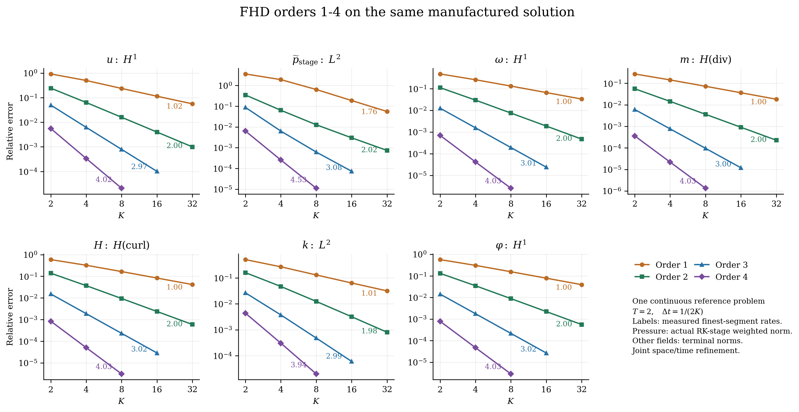

# FHD Algorithm 3: latest manuscript and 17-case data

本仓库保存 Rosensweig 铁磁流体论文、可检查的数值表、插图及重绘工具。当前主稿采用已经批准并编译的 2026-10-22 版本，包含一至四阶高阶方法和统一的17组收敛结果。

- [完整论文 PDF](previews/manuscript.pdf)
- [数值实验及绝对误差附录 PDF](previews/numerical_experiments.pdf)
- [全部17组绝对/相对误差与观测阶 CSV](data/convergence_17/ERRORS_AND_RATES_17_CASES.csv)
- [全精度 JSON](data/convergence_17/CONVERGENCE_17_CASES.json)
- [实验范围与解释](docs/NUMERICAL_SCOPE.md)
- [迁移与核验记录](docs/MIGRATION.md)

仓库为公开论文协作材料；公开访问不等于授予开源许可证，许可证状态沿用原仓库。

## 当前版本的内容

| 方法 | 网格 K | 终止时间 | 时间步 |
|---|---|---|---|
| 一阶 | 2, 4, 8, 16, 32 | 2 | 1/(2K) |
| 二阶 | 2, 4, 8, 16, 32 | 2 | 1/(2K) |
| 三阶 | 2, 4, 8, 16 | 2 | 1/(2K) |
| 四阶 | 2, 4, 8 | 2 | 1/(2K) |

所有组使用同一连续参考问题 `fhd-continuous-polynomial-v1`。七项指标是速度H1、实际RK阶段压力L2、角速度H1、磁化H(div)、磁场H(curl)、辅助旋度k-L2和磁势H1。数据共有119条算例/范数记录，主文四张相对误差表，附录四张绝对误差表。

这是联合空间/时间细化实验。压力是最后时间步实际阶段时刻上的去均值加权误差，其余六项是T=2端点范数。非齐次边界lifting、相容初值投影和辅助量端点恢复均有明确记录；不能将本表解释为原齐次算例逐式复现或独立时间阶证明。



[绝对误差图](figures/convergence_17/absolute_errors.png)

## 目录与唯一正文入口

```text
main.tex                       最新完整正文，保持批准稿原字节
figures/convergence_17/         一至四阶绝对/相对误差图及来源哈希
figures/applications/          保留的通道、台阶流图
figures/*_energy.*              保留的能量图
data/convergence_17/            冻结JSON、CSV、curl诊断、RK表与验收来源
data/energy/                    原能量曲线和来源
data/applications/              原通道、台阶流采样快照和来源
scripts/                       检查、生成表格、重绘和编译工具
previews/                      完整论文与数值章节摘录
docs/                          适用范围、归档说明、迁移与验证
legacy/2026-09-28/              旧收敛材料、旧实验章节和重绘脚本
```

`main.tex` 是唯一有效的论文正文。原稿中的旧 `sections/` 输入已经注释，旧章节移入legacy，不参与当前编译。`make experiments` 从完整PDF中提取数值章节和附录，保留原页码及交叉引用，不再维护第二份实验正文。

## 检查、重绘与编译

只核对数据、表格和哈希需要Python 3.9以上的标准库：

```bash
make check
make tables
```

`make tables` 从冻结数据生成八个TeX表片段到 `build/tables/`，同时逐字比较主稿对应表格，不覆盖论文。检查覆盖238个误差单元、182个Rate及17个curl诊断，也复核JSON/CSV、阶段压力权重和时刻。

重绘图和导出PDF摘录需安装 `requirements.txt` 中的Python依赖，推荐独立环境：

```bash
python3 -m venv .venv
.venv/bin/python -m pip install -r requirements.txt
make figures PYTHON=.venv/bin/python
make check PYTHON=.venv/bin/python
```

`make figures` 仅从现有JSON重绘两组PNG/PDF，使用Matplotlib的DejaVu字体与数学排版，不需要TeX、不执行FEM/MPI、不重新积分有限元场。每幅图旁的 `.source.json` 记录输入、脚本、环境及输出哈希。

编译主稿需要Tectonic或具备所需宏包的TeX Live/MacTeX与latexmk。自动优先选择PATH中的Tectonic：

```bash
make preview PYTHON=.venv/bin/python
# 或指定编译器：
make preview PYTHON=.venv/bin/python TEX_ENGINE=/path/to/tectonic
make preview PYTHON=.venv/bin/python TEX_ENGINE=latexmk
```

本次实际使用Tectonic 0.17.0完成32页编译。`make pdf` 输出 `build/main.pdf`；`make preview` 同步两份已提交PDF及来源记录。也可在Overleaf中以 `main.tex` 为主文件编译；本次未对Overleaf作独立运行验收。

能量和通道图的数据、图件及原脚本保持原样。它们是独立目标，不由 `make figures` 重绘：

```bash
make energy-figures PYTHON=.venv/bin/python
make application-figures PYTHON=.venv/bin/python TEX_ENGINE=/path/to/tectonic
```

能量重绘仍需原脚本所要求的LaTeX、dvipng和字体环境；通道重绘额外需要SciPy。详情保留在 [能量数据说明](data/energy/README.md) 和 [应用数据说明](data/applications/README.md)。此次迁移未重新生成或重新验证这些旧实验的科学结论。

## 历史与原生数据

旧版完整提交为 [`92a574e`](https://github.com/cheryl1595212353-ux/fhd-algorithm3-paper/tree/92a574ed028bdeb5f3fdac866a413cf50b10ee1b)，由存档分支 `archive/pre-17cases-20261023` 保留；Git历史不改写。legacy中的旧收敛数据属于不同参考问题和步长，不进入当前17组主表。

完整原生解、逐步检查点、失败现场、矩阵诊断及计算环境继续保存在外部科研归档。本仓库能复现表格与图形，不能单凭此仓库重新执行全部有限元计算。归档定位及验收字段的解释见 [原生数据说明](docs/RAW_DATA_ARCHIVE.md)。

原稿的三处重复参考文献键和两处轻微Overfull提示已记录在迁移说明中；本次整理保留批准稿内容，没有扩展为理论或参考文献修订。
